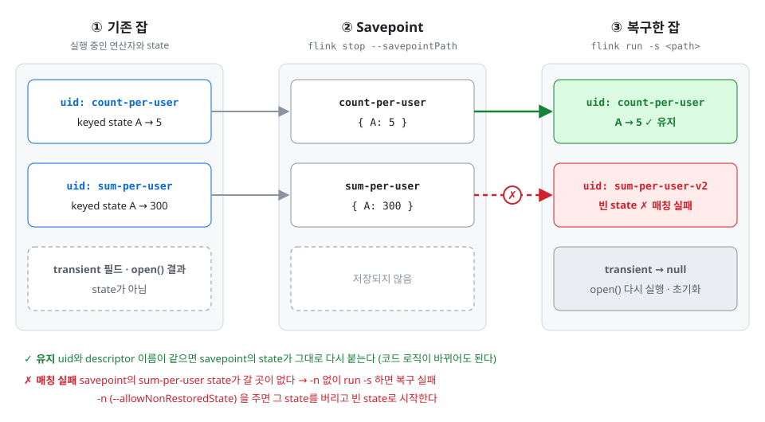

# Savepoint 복구 시 State 유지와 초기화

> 작성일: 2026-11-22

- 참조 : [Savepoints](https://nightlies.apache.org/flink/flink-docs-release-1.18/docs/ops/state/savepoints/) — Apache Flink 1.18
- 참조 : [Upgrading Applications and Flink Versions](https://nightlies.apache.org/flink/flink-docs-release-1.18/docs/ops/upgrading/) — Apache Flink 1.18
- 참조 : [Working with State](https://nightlies.apache.org/flink/flink-docs-release-1.18/docs/dev/datastream/fault-tolerance/state/) — Apache Flink 1.18
- 참조 : [The Broadcast State Pattern](https://nightlies.apache.org/flink/flink-docs-release-1.18/docs/dev/datastream/fault-tolerance/broadcast_state/) — Apache Flink 1.18
- 참조 : [State Schema Evolution](https://nightlies.apache.org/flink/flink-docs-release-1.18/docs/dev/datastream/fault-tolerance/serialization/schema_evolution/) — Apache Flink 1.18

- savepoint로 복구하면 Flink는 **state를 uid 단위로 다시 붙인다.** uid와 descriptor 이름이 같으면 keyed / operator / broadcast state 모두 그대로 유지된다.
- state가 아닌 것(`transient` 필드, `open()`에서 읽은 값, 생성자 인자)은 savepoint에 들어가지 않는다. 복구하면 **새로 초기화**된다.
- uid가 바뀌면 state는 갈 곳을 잃는다. 복구가 실패하거나, `-n`을 주면 **버리고** 빈 state로 시작한다.

## 목차

- [한눈에 보기](#한눈에-보기)
- [uid — state를 연산자에 다시 붙이는 키](#uid--state를-연산자에-다시-붙이는-키)
- [예시 1 — state가 유지되는 경우](#예시-1--state가-유지되는-경우)
- [예시 2 — state가 유지되지 않는 경우](#예시-2--state가-유지되지-않는-경우)
- [State의 종류](#state의-종류)
  - [keyed state — key마다 하나](#keyed-state--key마다-하나)
  - [operator state — task마다 하나](#operator-state--task마다-하나)
  - [broadcast state — 모든 task가 같은 내용](#broadcast-state--모든-task가-같은-내용)
  - [셋을 같이 쓰면](#셋을-같이-쓰면)
- [주의할 것](#주의할-것)
  - [복구된 broadcast state가 폴백보다 우선한다](#복구된-broadcast-state가-폴백보다-우선한다)
  - [put만 하면 broadcast state가 계속 쌓인다](#put만-하면-broadcast-state가-계속-쌓인다)
  - [state 클래스의 필드를 바꿀 때](#state-클래스의-필드를-바꿀-때)
- [관련 문서](#관련-문서)

## 한눈에 보기



| 대상 | 복구 후 |
| --- | --- |
| keyed state / operator state / broadcast state | savepoint 내용 **유지** (uid와 descriptor 이름이 같을 때) |
| `transient` 필드 | **초기화** (null) |
| `open()` | **다시 실행** — 그 안에서 DB를 읽었다면 다시 읽는다 |
| 생성자 인자 (잡 그래프에 직렬화되는 값) | 잡을 다시 제출하며 `main()`이 다시 돌므로 **새 값** |
| Kafka 오프셋 | savepoint 시점부터 다시 읽는다 → 멈춰 있던 동안 쌓인 **backlog**가 한꺼번에 들어온다 |

## uid — state를 연산자에 다시 붙이는 키

savepoint 안의 state는 연산자 ID별로 저장되고, 복구할 때 그 ID로 새 잡의 연산자를 찾아 붙인다.

> It is highly recommended that you specify operator IDs via the uid(String) method.
> These IDs are used to scope the state of each operator.
> The generated IDs depend on the structure of your program and are sensitive to program changes.

| 상황 | 복구 결과 |
| --- | --- |
| uid가 같음 | state **유지** (연산자 로직이 바뀌어도 된다) |
| uid를 안 줌 + 그래프 구조가 바뀜 | 자동 생성 ID가 바뀌어 **매칭 실패** |
| uid를 바꿈 / stateful 연산자를 삭제함 | 갈 곳 없는 state가 남아 **복구 실패**. `-n`을 주면 그 state를 **버리고** 시작 |
| 새 stateful 연산자를 추가함 | **빈 state**로 시작 ("initialized without any state") |
| 병렬도만 바꿈 | 그대로 복구된다 |
| stateless 연산자를 추가·삭제·순서 변경 | stateful 연산자에 uid가 있으면 영향 없음 |

stateless 연산자는 uid를 생략해도 된다. 다만 Window처럼 겉보기와 달리 state를 가진 내장 연산자가 있어서, 공식 문서는 **모든 연산자에 uid를 주라고 권한다.**

```java
stream.keyBy(Event::getUserId)
      .process(new CountPerUser())
      .name("Count per User")       // UI에 보이는 이름. 복구와는 무관
      .uid("count-per-user");       // savepoint 매칭 키. 한 번 정하면 바꾸지 않는다
```

```bash
bin/flink run -s <savepointPath> myjob.jar      # 기본: 모든 state가 매칭돼야 한다
bin/flink run -s <savepointPath> -n myjob.jar   # -n : 매칭 안 되는 state는 버리고 시작
```

## 예시 1 — state가 유지되는 경우

유저별로 이벤트 수를 세는 연산자다.

```java
public class CountPerUser extends KeyedProcessFunction<String, Event, Tuple2<String, Long>> {

    private transient ValueState<Long> count;   // 핸들은 transient, 값은 state

    @Override
    public void open(Configuration parameters) {
        count = getRuntimeContext().getState(new ValueStateDescriptor<>("count", Long.class));
    }

    @Override
    public void processElement(Event e, Context ctx, Collector<Tuple2<String, Long>> out) throws Exception {
        long next = (count.value() == null ? 0L : count.value()) + 1;
        count.update(next);
        out.collect(Tuple2.of(e.getUserId(), next));
    }
}

stream.keyBy(Event::getUserId).process(new CountPerUser()).uid("count-per-user");
```

```
1. 유저 A 이벤트 5건 처리                      → count(A) = 5
2. bin/flink stop --savepointPath <dir> <jobId>
3. 코드 수정 — 앞단에 filter 추가, 로그 추가    (uid "count-per-user", descriptor "count"는 그대로)
4. bin/flink run -s <savepointPath> myjob.jar
5. 유저 A 이벤트 1건                           → count(A) = 6   ✓ 이어서 센다
```

`count` 필드 자체는 `transient`라 복구 후 null이지만, `open()`이 다시 돌면서 같은 이름(`"count"`)의 state 핸들을 다시 얻는다. 그 핸들이 savepoint에서 복원된 값 5를 가리킨다. **필드는 초기화되고, state는 유지된다.**

## 예시 2 — state가 유지되지 않는 경우

같은 연산자에서 uid만 바꿨다.

```java
stream.keyBy(Event::getUserId).process(new CountPerUser()).uid("count-per-user-v2");   // 이름 정리한다고 바꿈
```

```
1. 유저 A 이벤트 5건 처리                      → count(A) = 5   (uid "count-per-user")
2. bin/flink stop --savepointPath <dir> <jobId>
3. uid를 "count-per-user-v2"로 변경
4. bin/flink run -s <savepointPath> myjob.jar
   → 복구 실패. savepoint의 "count-per-user" state를 붙일 연산자가 새 잡에 없다
4'. bin/flink run -s <savepointPath> -n myjob.jar
   → 기동은 된다. "count-per-user" state는 버려진다
5. 유저 A 이벤트 1건                           → count(A) = 1   ✗ 처음부터 다시 센다
```

`-n`은 "state를 옮겨 준다"가 아니라 **"못 붙이는 state는 버려도 된다"는 동의**다. 복구 실패를 `-n`으로 넘기면 조용히 state를 잃는다.

같은 결과가 나는 다른 경우:

| 원인 | 결과 |
| --- | --- |
| uid를 안 줬는데 앞단에 연산자를 추가함 | 자동 생성 ID가 바뀌어 예시 2와 같아진다 |
| descriptor 이름을 바꿈 (`"count"` → `"cnt"`) | 새 이름의 state는 비어 있다 |
| 값을 `transient` 필드나 일반 필드에만 들고 있었음 | 애초에 savepoint에 없다 |
| state 타입 클래스의 필드를 바꿨는데 Kryo로 직렬화되고 있었음 | 복구 자체가 실패한다 ([아래](#state-클래스의-필드를-바꿀-때) 참고) |

«추정» descriptor 이름을 바꿨을 때 예전 이름의 state는 아무도 읽지 않아 버려진다. 공식 문서에 직접 적혀 있지는 않다.

## State의 종류

| | keyed state | operator state | broadcast state |
| --- | --- | --- | --- |
| 붙는 단위 | **key** 하나 | **병렬 task** 하나 | 병렬 task 하나 (모든 task가 같은 내용) |
| 쓸 수 있는 곳 | `keyBy()` 뒤 | 어디서나 (source, sink 포함) | `broadcast()` + `connect()` 뒤 |
| 만드는 법 | `getRuntimeContext().getState(...)` | `CheckpointedFunction` + `getOperatorStateStore()` | `ctx.getBroadcastState(descriptor)` |
| 자료구조 | Value / List / Map 등 | List | Map |

아래는 같은 입력(병렬도 2)으로 각 state에 무엇이 저장되는지 본 것이다.

```
입력 이벤트 (user, action)
(A, click)  (B, view)  (A, click)  (C, click)  (B, click)
```

### keyed state — key마다 하나

`keyBy(user)` 뒤에서 유저별 클릭 수를 센다. key마다 맡는 task가 정해져 있다.

```
task 0 (A, C 담당)          task 1 (B 담당)
┌──────────────┐            ┌──────────────┐
│ A → 2        │            │ B → 1        │
│ C → 1        │            │              │
└──────────────┘            └──────────────┘
```

- A의 state는 A 이벤트가 들어올 때만 보인다. C를 처리할 때는 `C → 1`만 보인다
- 쓰는 곳: 유저별 누적값, 중복 체크, 세션

### operator state — task마다 하나

Kafka source가 파티션별로 어디까지 읽었는지 기록한다. key와 상관없이 task 단위로 저장된다.

```
task 0                          task 1
┌──────────────────────┐        ┌──────────────────────┐
│ [partition-0 → 120,  │        │ [partition-1 → 95,   │
│  partition-2 → 87]   │        │  partition-3 → 110]  │
└──────────────────────┘        └──────────────────────┘
```

- task 0은 A를 처리할 때나 C를 처리할 때나 **같은 리스트**를 본다
- 쓰는 곳: source의 offset, sink가 내보내기 전에 모아 두는 버퍼
- 복구했을 때 Kafka를 이어서 읽는 이유가 이것이다. **그래서 source와 sink에도 uid가 필요하다**

### broadcast state — 모든 task가 같은 내용

규칙 스트림으로 "action별 점수"를 뿌린다.

```
규칙 이벤트 : (click → 10점), (view → 1점)

task 0                          task 1
┌──────────────────┐            ┌──────────────────┐
│ click → 10       │            │ click → 10       │   ← 같은 내용
│ view  → 1        │            │ view  → 1        │
└──────────────────┘            └──────────────────┘
```

- 일반 이벤트를 처리할 때 읽어서 쓴다. `(A, click)`이면 10점
- 쓰는 곳: 규칙, 설정, 시즌 정보처럼 **작고 모든 task가 참조해야 하는 데이터**
- task마다 자기 복사본을 저장하므로 저장 크기가 state 크기 × 병렬도가 된다

### 셋을 같이 쓰면

유저별 점수를 매기는 잡 하나에 세 가지가 다 들어간다.

```
Kafka source        ── operator state  : partition-0 → 120      (어디까지 읽었나)
   │
   ▼  connect(규칙 broadcast)
점수 계산 (keyBy user)
                    ── broadcast state : click → 10, view → 1   (점수 규칙)
                    ── keyed state     : A → 20, B → 11, C → 10 (유저별 누적 점수)
```

savepoint로 복구하면 셋 다 그대로 돌아온다 — Kafka는 offset 120부터 다시 읽고, 규칙은 click=10이 남아 있고, A의 점수 20에 이어서 더한다. **각 연산자의 uid가 그대로일 때만.**

병렬도를 2 → 3으로 바꾸면,

| | 다시 나누는 방식 |
| --- | --- |
| keyed state | key 단위로 다시 나눈다 (예: `C → 1`만 새 task 2로 옮겨 간다) |
| operator state | 리스트 원소를 다시 나눈다 (파티션 4개를 task 3개에 2·1·1개씩) |
| broadcast state | 새 task 2가 기존 task의 복사본을 받는다 → 셋 다 `click → 10, view → 1` |

## 주의할 것

### 복구된 broadcast state가 폴백보다 우선한다

broadcast로 설정값(시즌, 정책 등)을 뿌리고, broadcast가 아직 도착하지 않았을 때를 위해 잡 시작 시 조회한 값을 폴백으로 두는 패턴이 흔하다.

```java
private Config effective(ReadOnlyContext ctx) throws Exception {
    Config current = ctx.getBroadcastState(CONFIG_DESCRIPTOR).get("current");
    return current != null ? current : fallbackLoadedAtStartup;   // 폴백: main() 또는 open()에서 DB 조회
}
```

| 기동 방식 | broadcast state | 실제로 쓰는 값 |
| --- | --- | --- |
| 처음 기동 | 비어 있음 | 폴백 — 방금 DB에서 읽은 값 |
| savepoint 복구 | **savepoint 시점 값으로 차 있음** | **savepoint 시점 값** — 방금 읽은 폴백은 무시된다 |

새 값이 broadcast로 도착하기 전까지는 **옛 값으로 판정한다.** broadcast source가 시작하자마자 조회해서 내보내더라도 다음 이유로 틈이 생긴다.

- broadcast 입력과 일반 입력 사이에는 **처리 순서 보장이 없다.**
- 복구 직후에는 Kafka backlog가 몰려 들어온다. 그 틈에 backlog 이벤트들이 옛 설정으로 통과되거나 버려진다.
- broadcast source의 조회가 실패해 아무것도 내보내지 않으면 옛 값이 **계속** 쓰인다.

savepoint를 뜬 뒤 설정을 바꾸고 복구할 때만 문제가 된다. 필요하면 복구된 값과 폴백 중 **더 최근 값**을 고르게(값에 조회 시각을 넣어 비교) 하거나, 첫 broadcast가 도착하기 전까지는 폴백을 우선 쓴다.

### put만 하면 broadcast state가 계속 쌓인다

```java
ctx.getBroadcastState(DESCRIPTOR).put(broadcast.getBroadcastNo(), broadcast);   // remove 없음
```

방송 번호처럼 계속 새로 생기는 값을 key로 넣고 지우지 않으면, 끝난 항목까지 **savepoint마다 × 병렬도 크기로 유지되고 실행 중에는 메모리를 차지한다.** 종료 이벤트를 받았을 때 `remove()` 하는 경로를 같이 만들어야 한다.

### state 클래스의 필드를 바꿀 때

> Currently, schema evolution is supported only for POJO and Avro types.
> Kryo cannot be used for schema evolution.

| state 타입이 직렬화되는 방식 | 필드 추가·삭제 후 복구 |
| --- | --- |
| Flink POJO | 가능 — 새 필드는 타입 기본값, 삭제한 필드는 버려진다. 필드 타입 변경·클래스 이름 변경은 불가 |
| Avro | 호환되는 스키마 변경이면 가능 |
| Kryo (GenericType) | **불가** — 필드 하나만 바꿔도 복구 실패 |

public 기본 생성자와 getter/setter(또는 public 필드)가 없으면 POJO가 아니라 Kryo로 처리된다. POJO 안의 필드라도 Kryo로 처리되는 타입이면 그 부분은 evolution이 안 된다. state에 넣는 클래스가 TaskManager 로그에 GenericType으로 처리된다고 찍히는지 미리 확인해 두면 좋다.

## 관련 문서

- [SavePoint & CheckPoint](savepoint-and-checkpoint.md) — savepoint 저장·중지·복구 명령
- [Broadcast State](broadcast-state.md)
- [State Snapshots](state-snapshots.md)
- [Stateful Stream Processing](stateful-stream-processing.md)
