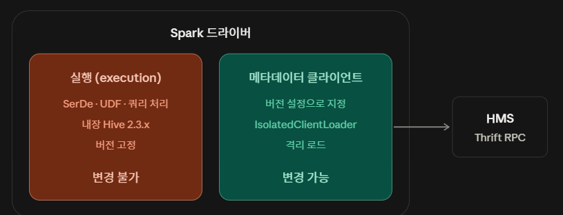

# Spark 안의 Hive — 실행과 메타데이터 클라이언트

> 작성일: 2026-11-01

- 참조 : [Hive Tables — Interacting with Different Versions of Hive Metastore](https://spark.apache.org/docs/latest/sql-data-sources-hive-tables.html) — Apache Spark 4.3.0
- 참조 : [Hive Tables (Spark 3.5.6)](https://spark.apache.org/docs/3.5.6/sql-data-sources-hive-tables.html) — Apache Spark

- Spark에서 "Hive를 쓴다"는 말은 **서로 다른 두 가지**를 가리킨다. 쿼리를 **실행**할 때 쓰는 Hive 코드와, HMS에서 **메타데이터를 조회**할 때 쓰는 Hive 클라이언트다.
- 두 역할은 **쓰는 Hive 버전도, 바꿀 수 있는지도 다르다.**
- 이 구분을 모르면 "Hive 버전을 맞췄는데 왜 안 되지?" 같은 혼란이 생긴다.

## 목차

- [한눈에 보기](#한눈에-보기)
- [실행(execution) 역할](#실행execution-역할)
  - [내장 버전은 Spark 버전마다 다르다](#내장-버전은-spark-버전마다-다르다)
- [메타데이터 클라이언트 역할](#메타데이터-클라이언트-역할)
  - [설정은 두 개를 함께 쓴다](#설정은-두-개를-함께-쓴다)
  - [IsolatedClientLoader](#isolatedclientloader)
  - [지원 버전 범위](#지원-버전-범위)
- [실제 사례 — Invalid method name: 'get_table'](#실제-사례--invalid-method-name-get_table)
- [Iceberg 카탈로그를 함께 쓸 때 주의](#iceberg-카탈로그를-함께-쓸-때-주의)
- [정리](#정리)
- [관련 문서](#관련-문서)

## 한눈에 보기



| 역할 | 하는 일 | 사용하는 Hive 버전 | 변경 가능 여부 |
| --- | --- | --- | --- |
| 실행 (execution) | Hive SerDe로 데이터 읽기·쓰기, Hive UDF 실행, Hive 호환 쿼리 처리 | Spark에 내장된 버전 (고정) | **불가** |
| 메타데이터 클라이언트 | HMS와 Thrift RPC로 통신해 DB·테이블·파티션 정보를 조회·변경 | `spark.sql.hive.metastore.version`으로 지정 | **가능** (IsolatedClientLoader) |

HMS와 통신하는 것은 **오른쪽의 메타데이터 클라이언트뿐이다.** 공식 문서의 문장이 이 구분을 그대로 말한다.

> "Note that **independent of the version of Hive that is being used to talk to the metastore**, internally Spark SQL will compile against built-in Hive and use those classes for internal execution (serdes, UDFs, UDAFs, etc)."

## 실행(execution) 역할

Spark는 Hive 테이블을 읽고 쓰거나 Hive 함수를 실행할 때, 배포판에 포함된 Hive 클래스를 그대로 쓴다.

이 역할에 해당하는 것은 다음과 같다.

- **SerDe** — Hive 형식 테이블(ORC, Parquet, Text 등)의 데이터를 직렬화·역직렬화하는 코드
- **Hive UDF** — Hive의 `UDF`/`GenericUDF`를 상속해 만든 함수 jar
- **Hive 호환 쿼리 처리** — Hive 문법 지원, Hive 테이블 쓰기 등

이 버전은 **Spark 빌드에 묶여 있어 설정으로 바꿀 수 없다.** 그래서 Hive UDF jar를 Spark에서 쓰려면, 그 jar가 내장 Hive 버전과 호환되어야 한다.

### 내장 버전은 Spark 버전마다 다르다

"Spark 3.x는 2.3.x"처럼 뭉뚱그리면 안 된다. 패치 버전까지 고정돼 있다.

| Spark | 내장 Hive (`builtin`) | `metastore.version` 기본값 |
| --- | --- | --- |
| 3.5.6 | **2.3.9** | `2.3.9` |
| 4.3.0 | **2.3.10** | `2.3.10` |

`builtin`을 쓰는 동안에는 `version`을 그 값 외의 다른 값으로 둘 수 없다. 공식 문서 표현이다.

> "Use Hive 2.3.10, which is bundled with the Spark assembly when `-Phive` is enabled. **When this option is chosen, `spark.sql.hive.metastore.version` must be either `2.3.10` or not defined.**"

`jars`는 그대로 둔 채 `version`만 바꾸면 여기서 막힌다.

## 메타데이터 클라이언트 역할

Spark가 `spark.table("db.tbl")`이나 `SELECT ... FROM db.tbl`을 처리하려면, 먼저 HMS에 **"이 테이블의 스키마·위치·파티션은 무엇인가"**를 물어봐야 한다. 이 통신은 Thrift RPC로 이루어지며, Spark 안의 Hive Metastore 클라이언트가 담당한다.

HMS 서버의 버전은 회사마다 다르다. 그래서 Spark는 **이 클라이언트의 버전만** 설정으로 바꿀 수 있게 해 두었다.

### 설정은 두 개를 함께 쓴다

| 설정 | 기본값 | 의미 |
| --- | --- | --- |
| `spark.sql.hive.metastore.version` | 내장 버전 | 어떤 버전의 HMS와 통신할지 |
| `spark.sql.hive.metastore.jars` | `builtin` | 그 버전의 클라이언트 jar를 어디서 가져올지 |
| `spark.sql.hive.metastore.jars.path` | (비어 있음) | `jars=path`일 때 jar 위치 |
| `spark.sql.hive.metastore.sharedPrefixes` | `com.mysql.jdbc, org.postgresql, com.microsoft.sqlserver, oracle.jdbc` | 격리하지 않고 **공유할** 클래스 접두사 |
| `spark.sql.hive.metastore.barrierPrefixes` | (비어 있음) | Hive 버전마다 **다시 로드할** 클래스 접두사 |

`jars`의 값은 **네 가지**다. 셋이 아니다.

| 값 | 의미 |
| --- | --- |
| `builtin` | 내장 Hive 클라이언트. `version`이 내장 버전과 같거나 미지정이어야 함 |
| `maven` | 지정한 버전을 Maven에서 내려받는다. 문서가 **"운영 배포에는 일반적으로 권장하지 않는다"**고 못 박음 |
| `path` | `jars.path`에 적은 jar를 쓴다. **로컬·원격 경로 모두 지원** |
| JVM 표준 클래스패스 문자열 | Hive와 **올바른 버전의 하둡을 포함한** 모든 의존성을 직접 나열 |

`path`와 클래스패스 방식 모두 **제공하는 jar가 `version`과 같은 버전이어야 한다.**

```properties
# 예시: HMS 3.1.3 서버에 붙는 경우
spark.sql.hive.metastore.version=3.1.3
spark.sql.hive.metastore.jars=path
spark.sql.hive.metastore.jars.path=/opt/hive-3.1.3-client/lib/*.jar
```

`jars.path`가 받는 형식은 넷이다.

```
file://path/to/jar/foo.jar
hdfs://nameservice/path/to/jar/foo.jar
/path/to/jar/                              ← 스킴 없으면 fs.defaultFS 를 따름
[http/https/ftp]://path/to/jar/foo.jar
```

**앞의 세 형식은 와일드카드를 지원한다.** (`http` 계열은 안 된다.)

> 클래스패스 방식은 jar가 **드라이버에만** 있으면 되지만, **yarn cluster 모드에서는 애플리케이션에 함께 패키징**해야 한다고 문서가 명시한다.

사내망처럼 외부 접근이 막힌 환경에서는 `maven` 대신 `path` 방식이 일반적이다.

### IsolatedClientLoader

실행 역할 때문에 Spark 본체에는 이미 내장 Hive 클래스가 올라와 있다. 여기에 다른 버전(예: 3.1.3)의 Hive 클래스를 같은 클래스로더에 올리면, **같은 이름의 클래스가 두 벌이 되어 충돌한다.**

그래서 Spark는 메타데이터 클라이언트용 Hive jar를 **별도의 격리된 클래스로더**로 로드한다. 다만 **모든 클래스를 격리하지는 않는다.**

| 구분 | 대상 | 로드 위치 |
| --- | --- | --- |
| 공유(shared) | `java.*`, `scala.*`, 로깅, 하둡 클래스, **JDBC 드라이버** | Spark 본체와 함께 사용 |
| 격리(barrier) | Hive 관련 클래스 | 격리 클래스로더에서 따로 로드 |

두 목록은 설정으로 넓힐 수 있다. 공식 문서의 설명이다.

- `sharedPrefixes` — "classes that should be shared is **JDBC drivers** that are needed to talk to the metastore. Other classes that need to be shared are those that interact with classes that are already shared. For example, **custom appenders** that are used by log4j."
- `barrierPrefixes` — "class prefixes that should **explicitly be reloaded for each version of Hive**... For example, Hive UDFs that are declared in a prefix that typically would be shared (i.e. `org.apache.spark.*`)."

**하둡 클래스는 공유된다.** 그래서 지정한 Hive 클라이언트 버전이 Spark의 하둡 버전과 맞지 않으면, 격리를 해도 다른 종류의 오류가 날 수 있다. 클래스패스 방식 설명에 "including the correct version of Hadoop"이 붙어 있는 이유다.

### 지원 버전 범위

`version`에 아무 값이나 넣을 수는 없다. **Spark 버전마다 지원 범위가 다르다.**

| Spark | 지원하는 HMS 버전 |
| --- | --- |
| 3.5.6 | `0.12.0` ~ `2.3.9`, `3.0.0` ~ `3.1.3` |
| 4.3.0 | `2.0.0` ~ `2.3.10`, `3.0.0` ~ `3.1.3`, **`4.0.0` ~ `4.1.0`** |

두 가지가 눈에 띈다.

- **Spark 3.5에는 Hive 4.x가 없다.** Hive 4 HMS에 붙으려면 Spark를 올려야 한다
- 반대로 Spark 4.3은 **아주 오래된 버전(0.12~1.x)을 떨궜다.** 하한이 `2.0.0`이다

> 정확히 어느 Spark 4.x 버전부터 Hive 4 지원이 들어갔는지는 확인하지 않았다. 4.3.0 문서에 있다는 것만 확인했다.

## 실제 사례 — Invalid method name: 'get_table'

```
org.apache.thrift.TApplicationException: Invalid method name: 'get_table'
    at ...ThriftHiveMetastore$Client.get_table(...)
    at ...HiveMetaStoreClient.getTable(...)
    at org.apache.spark.sql.hive.client.HiveClientImpl...
```

스택에 **`HiveClientImpl`**이 보이므로, 이 에러는 **메타데이터 클라이언트 역할**에서 났다. 클라이언트가 `get_table`이라는 Thrift 메서드를 호출했는데, HMS 서버의 Thrift 인터페이스에 **그 메서드가 없다**는 응답이다.

짚어볼 원인은 둘이다.

| 원인 | 확인 방법 |
| --- | --- |
| 클라이언트·서버 버전 불일치 | 기본 설정(내장 2.3.x 클라이언트)으로 Hive 4.x HMS에 붙고 있지 않은지 |
| 접속 포트가 HMS가 아님 | HMS는 보통 **9083**. HiveServer2(**10000**)로 붙으면 같은 에러가 난다 |

해결 방향은 위 설정으로 **클라이언트 버전을 HMS 서버에 맞추는 것**이다. 이때 실행 역할(내장 버전)은 그대로 두고 **메타데이터 클라이언트만** 바꾼다.

```properties
spark.sql.hive.metastore.version=4.0.0
spark.sql.hive.metastore.jars=path
spark.sql.hive.metastore.jars.path=/opt/hive-4.0.0-client/lib/*.jar
```

Spark 3.5 이하라면 이 설정 자체가 막히므로 **Spark를 올리는 것 외에 방법이 없다.**

> Hive 4.0에서 오래된 Thrift 메서드가 정리되어 `get_table` 대신 요청 객체를 받는 형태(`get_table_req` 등)를 쓴다는 설명은 **추정이다.** Hive 쪽 공식 문서로 확인하지 않았다.

## Iceberg 카탈로그를 함께 쓸 때 주의

Iceberg 테이블을 `HiveCatalog`(`spark.sql.catalog.<이름>.type=hive`)로 읽는 경우, **Iceberg는 위의 IsolatedClientLoader를 거치지 않는다.** 클래스패스에 있는 Hive 클라이언트로 HMS에 직접 붙는다.

| 경로 | 사용하는 HMS 클라이언트 | `spark.sql.hive.metastore.*` 영향 |
| --- | --- | --- |
| `spark_catalog` (Spark 기본 카탈로그) | IsolatedClientLoader로 로드한 클라이언트 | **받음** |
| Iceberg `HiveCatalog` | 클래스패스의 Hive 클라이언트 (보통 내장 버전) | **받지 않음** |

즉 `spark.sql.hive.metastore.version`을 맞춰 `spark_catalog` 쪽 에러를 해결해도, **Iceberg 카탈로그로 같은 HMS에 붙을 때 같은 에러가 다시 날 수 있다.**

이 경우 선택지는 둘이다.

- Iceberg 런타임과 클래스패스의 Hive 클라이언트 버전을 HMS에 맞춘다
- HMS Thrift를 직접 쓰지 않는 방식(**Iceberg REST 카탈로그**)을 검토한다

> 이 절은 **추정이다.** Iceberg `HiveCatalog`가 Spark의 IsolatedClientLoader를 거치지 않는다는 점을 Iceberg 공식 문서에서 확인하지 못했다. 실제 환경에서 스택 트레이스로 검증해야 한다.

## 정리

- Spark 안의 Hive는 **실행**과 **메타데이터 클라이언트** 두 역할로 나뉜다
- 실행 역할은 내장 Hive로 **고정**이다 (Spark 3.5.6 → 2.3.9, 4.3.0 → 2.3.10). Hive UDF·SerDe jar는 이 버전과 호환되어야 한다
- 메타데이터 클라이언트는 `version`과 `jars`를 **함께** 설정해 HMS 서버 버전에 맞출 수 있다. `jars`를 안 바꾸면 `version`만 바꿔도 막힌다
- 다른 버전의 클라이언트는 **IsolatedClientLoader로 격리 로드**되어 실행 역할의 Hive 클래스와 충돌하지 않는다. 단 **하둡·JDBC 드라이버는 공유**된다
- 지원 범위는 Spark 버전에 묶여 있다. **Hive 4 HMS는 Spark 4.x부터**
- Iceberg `HiveCatalog`는 이 설정의 영향을 받지 않으므로 별도로 버전을 맞춰야 한다

## 관련 문서

- [Spark Cache와 Persist](spark-cache-and-persist.md)
- [Hive 아키텍처](../hive/architecture.md)
- [Spark Iceberg 예제](../iceberg/spark-iceberg-example.md)
